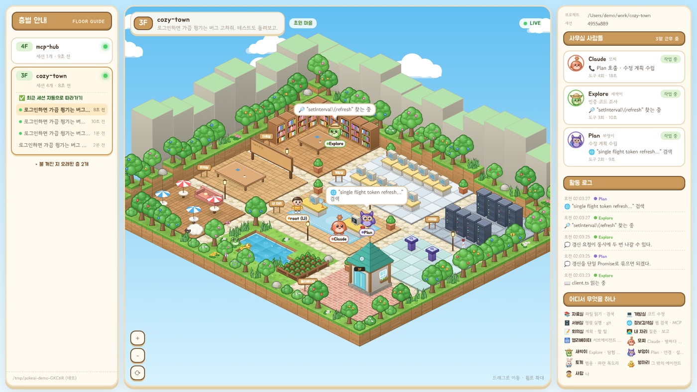

# PokeAI
Show currently working AI

Claude Code가 터미널에서 무엇을 하는지 아기자기한 블록 마을로 보여준다.
Claude(모찌)는 파일을 읽을 땐 자료실로, 명령을 돌릴 땐 서버실로 걸어가고,
일을 나눠 맡기면 서브에이전트 친구들이 엘리베이터를 타고 출근한다.



## 실행

```bash
node server.js            # http://localhost:4848
node server.js --demo     # Claude Code 없이 가짜 세션으로 구경하기
```

- Node.js 18 이상만 있으면 된다. 설치할 패키지가 없다.
- Claude Code의 훅이나 설정을 건드리지 않는다. `~/.claude/projects` 아래 세션 기록(jsonl)을 0.25초마다 이어서 읽기만 한다.
- 서버는 `127.0.0.1`에만 열린다. 내 PC에서만 볼 수 있다.

| 옵션 | 설명 |
| --- | --- |
| `--port 4848` | 포트 |
| `--dir <경로>` | 세션 기록 폴더 (기본값: `$CLAUDE_CONFIG_DIR/projects` 또는 `~/.claude/projects`) |
| `--demo` | 임시 폴더에 가짜 세션을 계속 써 넣으며 보여준다 |

## 마을 구조

**층 = 프로젝트, 매장 = 세션.** 왼쪽 층별 안내에서 층을 누르면 `▲ 3F` 엘리베이터 표시등이 뜨고 그 층으로 이동한다.
지금 일하는 층엔 초록불이 켜지고, `/clear` 하면 같은 층의 새 세션으로 알아서 따라간다.
층마다 초원·해변·황금 고원·설원 풍경이 바뀐다.

| 방 | 하는 일 | Claude의 작업 소품 |
| --- | --- | --- |
| 📚 자료실 | 파일 읽기, 검색 (`Read`, `Grep`, `Glob`) — 책을 펴고 읽는다 | 동그란 안경 |
| 💻 개발실 | 코드 수정 (`Edit`, `Write`) — 모니터에 코드가 흐른다 | 안전모 |
| 🗄️ 서버실 | 명령 실행, git (`Bash`) — 돌리는 동안 랙 불빛이 빨라진다 | 헤드셋 |
| 🌐 정보검색실 | 웹 검색, MCP 도구 — 지구본이 돌고 안테나가 신호를 보낸다 | 안테나 머리띠 |
| 📝 회의실 | 계획, 할 일 (`TodoWrite`, 플랜 모드) — 게시판에 메모가 붙는다 | 베레모와 연필 |
| 🧑‍💻 내 자리 | 물어볼 게 생기면 (`AskUserQuestion`) 내 책상까지 찾아온다 | |
| 🛗 엘리베이터 | 서브에이전트 출퇴근 | |

- 생각할 땐 생각 요약이 구름 말풍선으로 뜬다. 오래 조용하면 그 자리에서 `?`를 띄우고 고민한다.
- 도구가 실패하면 식은땀을 흘리며 빨간 말풍선을 띄운다.
- 승인이 필요해 보이는 도구가 7초 넘게 끝나지 않으면 "승인 기다리는 중일까요?"라고 묻는다 (기록만으로는 확실히 알 수 없어서 추정이다).
- 오래 쉬면 자리에서 존다.

## 등장인물


| 캐릭터 | 누구 |
| --- | --- |
| 모찌 — 별꽃 새싹이 난 코랄색 찹쌀떡 | Claude |
| 새싹이 — 탐험 모자와 돋보기 | Explore 서브에이전트 |
| 부엉이 — 둥근 안경과 설계도 | Plan 서브에이전트 |
| 토끼 — 파란 목도리 | 범용(general-purpose) 서브에이전트 |
| 병아리 — 작은 가방 | 그 밖의 서브에이전트 |
| 후드티 입은 사람 | 나 |
| 양, 개구리, 오리, 나비 | 마을 주민 (쉼터에서 낮잠, 연못가에서 뜀뛰기, 연못 헤엄) |

Claude가 일을 맡기면 자기 자리에서 전화를 걸고, 새 에이전트가 엘리베이터에서 뿅 하고 나타난다.
일이 끝나면 Claude 옆으로 걸어와 결과를 보고하고 "👋 퇴근합니다!" 하고 엘리베이터로 사라진다.
보고하러 가다가 일을 하나 더 받으면 다시 일하러 돌아간다.

캐릭터와 마을 그림은 모두 이 프로젝트를 위해 캔버스 코드로 직접 그린 오리지널이다. 외부 이미지 파일을 쓰지 않는다.

## 파일

- `server.js` — 세션 목록과 jsonl 증분 읽기 API, 정적 파일 서버
- `demo.js` — `--demo` 용 가짜 세션 작성기
- `public/art.js` — 등각 좌표, 음영 진 블록, 스프라이트 캐시 같은 공통 그리기 도구
- `public/world.js` — 지형, 방과 소품, 길찾기, 렌더링
- `public/critters.js` — 캐릭터 그리기
- `public/app.js` — 기록 → 캐릭터 행동 변환, 패널 UI
