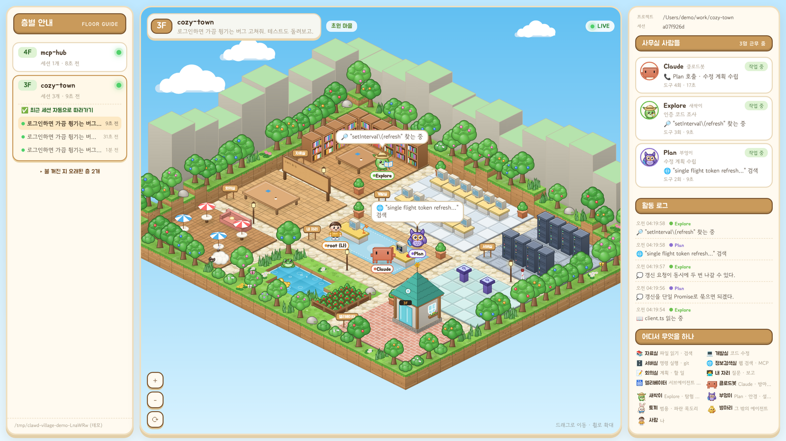
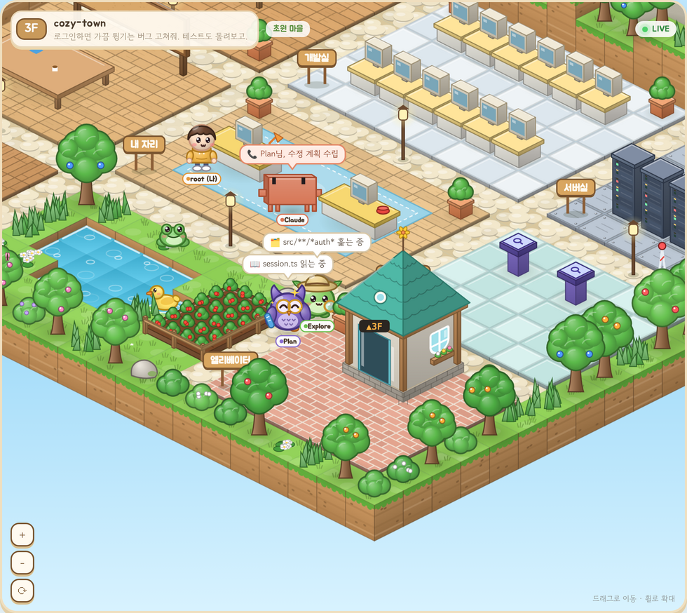
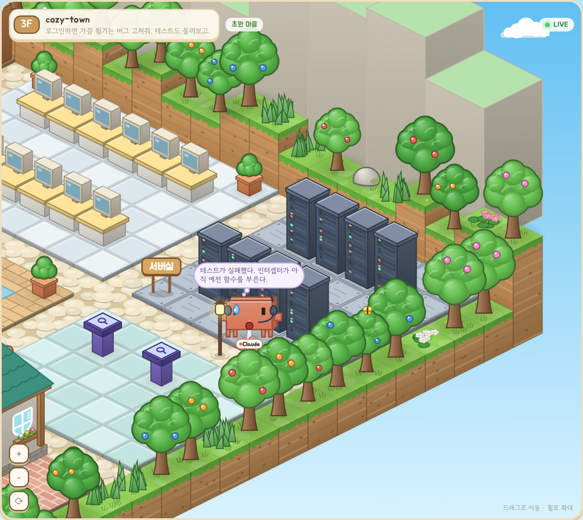
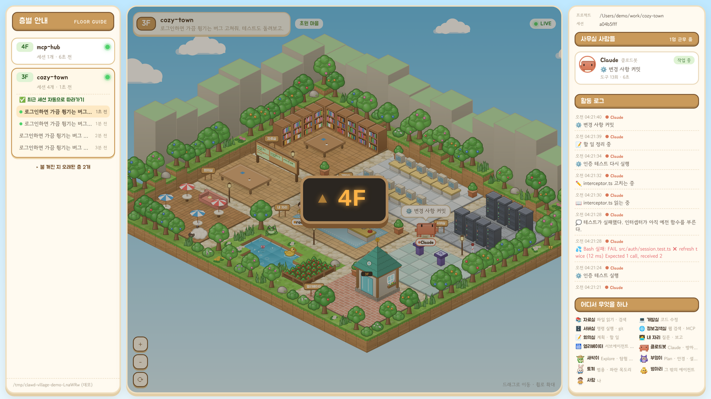
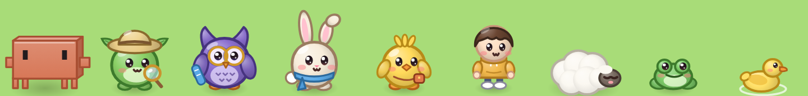

<div align="center">

# 클로드봇 마을 · Clawd Village

**Claude Code가 지금 무엇을 하는지 블록 마을로 보여주는 로컬 뷰어**

파일을 읽으면 자료실로, 명령을 돌리면 서버실로, 일을 나눠 맡기면 서브에이전트가 엘리베이터로 출근한다.



</div>

<table>
  <tr>
    <td width="50%"></td>
    <td width="50%"></td>
  </tr>
  <tr>
    <td align="center"><b>서브에이전트 출근</b><br>Claude가 자리에서 전화를 걸면 엘리베이터에서 Explore·Plan이 나타난다</td>
    <td align="center"><b>테스트 실패</b><br>서버실에서 헤드셋을 쓴 채 식은땀을 흘리며 원인을 고민한다</td>
  </tr>
</table>

## 목차

- [빠른 시작](#빠른-시작)
- [화면 읽는 법](#화면-읽는-법)
- [등장인물](#등장인물)
- [동작 방식](#동작-방식)
- [알려진 한계](#알려진-한계)
- [파일 구조](#파일-구조)

## 빠른 시작

Node.js 18 이상과 최신 브라우저(Chrome, Edge, Firefox, Safari)만 있으면 된다. 설치할 패키지는 없다.

```bash
git clone https://github.com/jjeonyo/PokeAI.git
cd PokeAI
node server.js          # 브라우저에서 http://localhost:4848 열기
```

Claude Code 없이 먼저 구경하려면 데모 모드로 실행한다. 임시 폴더에 가짜 세션을 계속 써 넣는다.

```bash
node server.js --demo
```

| 옵션 | 환경변수 | 기본값 | 설명 |
| --- | --- | --- | --- |
| `--port <번호>` | `PORT` | `4848` | 서버 포트 |
| `--dir <폴더>` | `CLAUDE_PROJECTS_DIR` | `~/.claude/projects` | 세션 기록 폴더. `CLAUDE_CONFIG_DIR`가 있으면 `$CLAUDE_CONFIG_DIR/projects` |
| `--host <주소>` | | `127.0.0.1` | 서버가 열릴 주소. 아래 [보안](#보안) 참고 |
| `--demo` | | 꺼짐 | 가짜 세션으로 보여주기 |

옵션 값은 `--port 5000`처럼 띄어 써도 되고 `--port=5000`처럼 붙여 써도 된다.

서버를 켜면 터미널에 `읽는 위치`가 찍힌다. 왼쪽 패널 맨 아래에도 같은 경로가 나온다. 마을이 비어 있으면 이 경로가 실제 세션 기록 폴더인지 확인한다.

**화면 조작**
- 드래그로 이동, 휠 또는 `＋` `－` 버튼으로 확대·축소, `⟳`로 전체 보기.
- 주소창에 지금 층이 `#floor=…`로 남아서 북마크하거나 새로고침하면 그 층으로 다시 열린다. 이미 열린 탭에서 북마크를 누르거나 주소창의 `#floor=…`를 고쳐도 그 층으로 옮긴다. 세션을 직접 골랐으면 `&session=…`도 붙고, 그 주소로 열면 그 세션이 자동 따라가기가 꺼진 채로 열린다. 그 세션이 지워졌거나 층별 안내의 최근 30개 밖으로 밀려났으면 `&session=…`은 무시된다.
- 브라우저 창 너비가 1100px 이하이면 오른쪽 패널이 숨겨지고, 720px 이하이면 층별 안내가 지도 아래로 내려간다. 터미널 옆에 좁게 띄우면 사람 목록과 활동 로그가 안 보이니 창을 넓히거나 브라우저 배율을 줄인다.

## 화면 읽는 법

### 층 = 프로젝트, 세션 = 그 층의 매장



- 층 번호는 프로젝트를 처음 쓴 순서대로 1F부터 매긴다. 처음 열면 가장 최근에 기록이 쌓인 층으로 간다.
- 왼쪽 **층별 안내**에서 다른 층을 누르면 엘리베이터 표시등이 `▲ 4F`(올라갈 때)나 `▼ 2F`(내려갈 때)처럼 한 층씩 바뀌고, 표시등이 꺼지면 그 층에 도착한다.
- 최근 2분 안에 기록(서브에이전트 기록 포함)이 쌓인 세션이 하나라도 있는 층에는 초록불이 켜진다. 층별 안내의 세션 목록에서도 그런 세션 앞에 초록 점이 붙는다. 사흘 넘게 조용한 층은 "불 꺼진 지 오래된 층"으로 접힌다.
- 화면 위쪽 배지는 지금 화면에 띄운 세션만 본다. 그 세션에 2분 안에 기록이 쌓였거나, 끝나지 않은 도구(긴 명령, 서브에이전트 호출 등)를 기다리는 중이면 `LIVE`, 아니면 `쉬는 중`이다. 지금 보고 있는 층의 불도 이 배지를 따른다. 그래서 같은 층의 다른 세션이 일하고 있으면 층에 불이 켜져 있어도 배지는 `쉬는 중`일 수 있다.
- 층에 들어가면 그 층에서 가장 나중에 시작한 세션을 연다. 같은 층에 새 세션이 생기면(`/clear` 포함) 그 세션으로 자동으로 따라간다.
- 층별 안내에서 다른 세션을 직접 누르면 자동 따라가기가 꺼진다. "최근 세션 자동으로 따라가기"를 다시 누르거나 다른 층으로 옮기면 다시 켜진다.
- 풍경은 층 번호로 정해진다. 1·3·5층은 초원, 2층은 해변, 4층은 황금 고원, 6층은 설원이고, 7층부터는 같은 순서가 되풀이된다.

### 방 = 도구

| 방 | 이럴 때 간다 | 화면 변화 | Claude 작업 소품 |
| --- | --- | --- | --- |
| 📚 자료실 | `Read` `Grep` `Glob` `LS` `NotebookRead` | 책을 펴고 읽는다 | 동그란 안경 |
| 💻 개발실 | `Edit` `Write` `MultiEdit` `NotebookEdit` | 모니터에 코드가 흐른다 | 안전모 |
| 🗄️ 서버실 | `Bash` `BashOutput` `Monitor` `KillShell` `KillBash` `PowerShell` | 랙 불빛이 빨라진다 | 헤드셋 |
| 🌐 정보검색실 | `WebSearch` `WebFetch` `ToolSearch` `ListMcpResourcesTool` `ReadMcpResourceTool`, MCP 도구(`mcp__`로 시작하는 도구) | 지구본이 돌고 안테나가 신호를 보낸다 | 안테나 머리띠 |
| 📝 회의실 | `TodoWrite` `TaskCreate` `TaskUpdate` `TaskList` `TaskGet` `TaskOutput` `Skill`, 플랜 모드 | 게시판에 할 일 메모가 붙는다 (`TodoWrite`일 때만) | 베레모와 연필 |
| 🧑‍💻 내 자리 | `AskUserQuestion` | 내 책상까지 찾아와 묻는다 | |
| 🛗 엘리베이터 | `Agent`(`Task`) | Claude가 자기 자리에서 전화를 걸고, 서브에이전트가 출퇴근한다 | |

`SendMessage`를 쓰면 Claude는 자기 자리로 돌아가 연락한다. 이 표에 없는 도구는 개발실로 간다.

### 말풍선과 표정

| 보이는 것 | 뜻 |
| --- | --- |
| 흰 말풍선 | 지금 쓰는 도구, Claude·서브에이전트의 답변, 내가 보낸 메시지 |
| 보라 구름 말풍선 | 생각 요약 (`thinking`) |
| 빨간 말풍선 + 식은땀 | 도구 실패, 또는 API 오류 |
| 노란 말풍선 | 나에게 묻는 질문, 또는 승인을 기다리는 것으로 보이는 상태 |
| 초록 말풍선 + 웃는 눈 | 서브에이전트의 결과 보고. 일이 실패했으면 빨간 말풍선으로 "죄송해요…" 하고 보고한다 |
| 주황 말풍선 + 전화기 | 서브에이전트를 부르는 중 |
| `?` + "고민 중… N초째" | Claude가 답변 도중에, 돌고 있는 도구 없이 20초 넘게 새 기록이 없음 (`LIVE`일 때만) |
| `z z z` | 답변을 마치고 3분 넘게 쉬는 중 |

오른쪽 패널에는 프로젝트 경로와 세션 ID, 사무실에 있는 캐릭터의 상태와 도구 사용 횟수, 최신 항목이 위에 오는 활동 로그, 방과 캐릭터 안내가 나온다. 도구 사용 횟수는 처음 열 때 읽은 범위부터 센다.

## 등장인물



| 캐릭터 | 맡은 역할 |
| --- | --- |
| **클로드봇** — Claude Code 터미널 마스코트. 주황색 블록 몸, 네모 눈, 네 다리 | Claude |
| **새싹이** — 탐험 모자와 돋보기 | Explore 서브에이전트 |
| **부엉이** — 둥근 안경과 설계도 | Plan 서브에이전트 |
| **토끼** — 파란 목도리 | 범용(general-purpose) 서브에이전트 |
| **병아리** — 작은 가방 | 그 밖의 서브에이전트 |
| **후드티 입은 사람** | 나 |
| **양 · 개구리 · 오리 · 나비** | 마을 주민. 양은 쉼터에서 낮잠, 개구리는 연못가에서 뜀뛰기, 오리는 연못에서 헤엄, 나비는 꽃 위를 난다 (나비는 위 그림에 없다) |

서브에이전트는 일이 끝나면 Claude 옆으로 걸어와 결과를 보고하고 "👋 퇴근합니다!" 하고 엘리베이터로 사라진다. 보고하러 가거나 퇴근하던 중에 그 서브에이전트 기록에 새 도구 호출이나 생각이 찍히면 다시 일하러 돌아간다. 그 뒤로는 끝나지 않은 도구 없이 30초 동안 새 기록이 없거나 배지가 `쉬는 중`이 되면 다시 보고하러 온다. 돌아가서 시작한 도구(긴 명령 등)가 아직 끝나지 않았으면 결과가 기록될 때까지 일하는 중으로 보이고, 결과가 30분 넘게 안 오면 끝난 것으로 본다.

클로드봇은 Claude Code 2.1.304 실행 파일에 들어 있는 마스코트 기본 스프라이트를 옮겨 입체로 그렸다. 터미널의 사분 블록 문자를 픽셀로 풀어서 모양과 비율(몸통 13×4 픽셀, 픽셀 하나는 가로 1 : 세로 2)을 맞췄고, 색은 `rgb(215,119,87)`을 그대로 썼다. 표정은 원래 스프라이트에 있는 것(뜬 눈, 걸을 때 가는 쪽 보기, 감은 눈)을 쓴다. `> <` 눈은 원래 스프라이트에 없는 표정인데, 서브에이전트의 보고를 받을 때와 답변을 마칠 때만 잠깐 쓴다. 나머지 캐릭터와 마을 그림은 이 프로젝트를 위해 직접 디자인했다. 모두 캔버스 코드로 그리며 외부 이미지 파일을 쓰지 않는다.

## 동작 방식

1. Claude Code는 대화를 `~/.claude/projects/<프로젝트>/<세션>.jsonl`에 한 줄씩 기록한다.
2. 브라우저가 0.25초마다 `server.js`에 새 기록을 묻는다. `server.js`는 그때마다 기록 파일을 지난번에 읽은 곳부터 이어 읽고, 화면에 필요한 이벤트만 추려 돌려준다. 추리는 이벤트는 내 메시지, `/clear` 같은 명령, 도구 호출과 결과, 생각, 답변, 중단, 턴 종료, API 오류, 대화 압축, 세션 이름이다.
3. 서브에이전트 기록(`<세션>/subagents/*.jsonl`, 예전 버전의 `agent-*.jsonl`)도 함께 읽어 각 캐릭터를 움직인다.
4. 처음 열 때는 최근 기록을 빠르게 재생해서 현재 상태(누가 어디서 무엇을 하는지)를 맞춘다.

- Claude Code의 훅이나 설정을 바꾸지 않는다. 기록 파일을 읽기만 한다.
- 외부로 나가는 요청은 웹 글꼴(Google Fonts)뿐이다.

### 보안

- 서버는 기본으로 `127.0.0.1`에만 열리므로 이 PC에서만 볼 수 있다. 세션 내용은 PC 밖으로 나가지 않는다.
- 요청의 Host 헤더가 `localhost`, `127.0.0.1`, `[::1]`, `--host`로 준 주소가 아니면 거절한다. 다른 웹사이트가 이 서버를 몰래 읽어 가지 못하게 하려는 것이다(DNS 리바인딩 방지).
- 다른 기기에서 보려면 `--host`에 이 PC의 IP(예: `192.168.0.10`)를 주고, 그 주소(`http://192.168.0.10:4848`)로 연다. 이러면 같은 네트워크의 누구나 세션 기록을 볼 수 있다. `--host 0.0.0.0`으로 열면 다른 기기의 요청은 Host 확인에서 거절된다.

## 알려진 한계

- **승인 대기는 추정이다.** 기록에는 권한 확인 창이 남지 않는다. 그래서 Claude가 직접 쓴 도구가 7초 넘게 끝나지 않으면 승인을 기다리는 것으로 본다. 원래 오래 걸릴 수 있는 도구는 이 추정에서 빠진다. 빠지는 것은 `Bash` `BashOutput` `Monitor` `PowerShell` `TaskOutput` `WebFetch` `WebSearch` `AskUserQuestion` `SendMessage`, 서브에이전트 호출(`Agent`·`Task`), MCP 도구, 그리고 서브에이전트가 쓴 도구다. 이런 도구가 승인을 기다릴 때는 노란 말풍선이 뜨지 않는다. 반대로 그 밖의 도구는 승인 없이 오래 걸리기만 해도 노란 말풍선이 뜰 수 있다.
- **한 층에는 한 세션만 보인다.** 같은 프로젝트에서 세션 여러 개를 동시에 돌리면 가장 나중에 시작한 세션을 따라간다. 먼저 시작한 세션이 지금 더 바쁘게 일하고 있어도 마찬가지다. 다른 세션은 층별 안내에서 직접 고른다.
- **층별 안내에는 층마다 최근 세션 30개까지만 나온다.** 처음에는 8개만 보이고 `세션 N개 더 보기`로 나머지를 펼친다. 층 이름 아래 `세션 N개`는 전체 개수라서 목록보다 많을 수 있다.
- **처음 열 때는 세션 끝부분 2MB만 읽는다.** 아주 긴 세션에서는 그보다 앞선 할 일 목록이 빠질 수 있다. 서브에이전트를 부른 호출이 이 범위보다 앞에 있으면, 그 서브에이전트는 자기 기록만 보고 유형별 기본 방으로 바로 데려온다. 일이 끝나면 호출 결과에 적힌 서브에이전트 ID로 찾아 보고하고 퇴근한다. 기록에 ID가 없으면 위의 "다시 일하러 돌아간" 서브에이전트와 같은 규칙으로 끝을 추정한다.
- **서브에이전트 기록은 처음 열 때 최근 30분 안에 쓰인 것만 끝부분 128KB를 읽는다.** 30분 넘게 아무것도 쓰지 않은 서브에이전트는 처음 열 때 자기 기록을 읽지 않아서 무엇을 하는지 알 수 없다. 그 서브에이전트를 부른 호출이 읽은 범위 안에 있고 세션이 아직 일하는 중이면 유형별 기본 방에 "일하는 중"으로 서 있고, 아니면 보이지 않다가 다음 기록을 남길 때 엘리베이터를 거치지 않고 바로 나타난다.
- **긴 명령을 기다리는 동안에는 기록이 멈춘다.** Claude Code는 명령이 도는 동안 기록 파일에 아무것도 쓰지 않는다. 그래서 다른 층의 불은 2분이 지나면 꺼진다. 지금 보고 있는 세션은 끝나지 않은 도구가 있으면 마지막 기록 뒤 30분까지 일하는 중으로 본다. 반대로 Claude Code를 명령 도중에 강제로 끄면, 그 뒤 30분 동안은 일하는 중으로 남아 보일 수 있다.
- **백그라운드 서브에이전트는 끝을 추정한다.** `run_in_background`로 부르거나 도중에 백그라운드로 돌린 서브에이전트는, Claude Code가 호출 결과를 일이 끝날 때가 아니라 시작할 때 남긴다. 진짜 완료 소식은 나중에 따로 오는데 이 앱은 그것을 읽지 않는다. 그래서 "다시 일하러 돌아간" 서브에이전트와 같은 규칙(끝나지 않은 도구 없이 30초 동안 새 기록이 없으면)으로 끝을 추정하고, 실제 결과 대신 "보고: 다 했어요!"라고 보고한 뒤 퇴근한다.
- **4MB가 넘는 한 줄짜리 기록은 건너뛴다.** 큰 이미지나 PDF를 읽은 결과가 이렇게 빠지면 그 도구가 끝나지 않은 것처럼 보이고, 승인을 기다린다는 말풍선이 잘못 뜰 수 있다.
- **오래된 세션 기록을 지우면 층 번호와 풍경이 바뀔 수 있다.** 층 번호를 남아 있는 기록 가운데 가장 오래된 것 기준으로 매기기 때문이다.

## 파일 구조

```text
server.js            세션 목록 · jsonl 증분 읽기 API, 정적 파일 서버
demo.js              --demo 용 가짜 세션 작성기
package.json         npm start / npm run demo 스크립트 (의존성 없음)
.coderabbit.yaml     CodeRabbit 리뷰 설정 (한국어, 초안 PR 포함)
public/
├── index.html       화면 틀
├── style.css        패널과 UI 스타일
├── app.js           기록 → 캐릭터 행동, 층 안내 · 사람 목록 · 활동 로그
├── world.js         지형, 방과 소품, 길찾기, 렌더링
├── critters.js      캐릭터 그리기
└── art.js           등각 좌표, 음영 블록, 스프라이트 캐시
docs/                README 이미지
```
